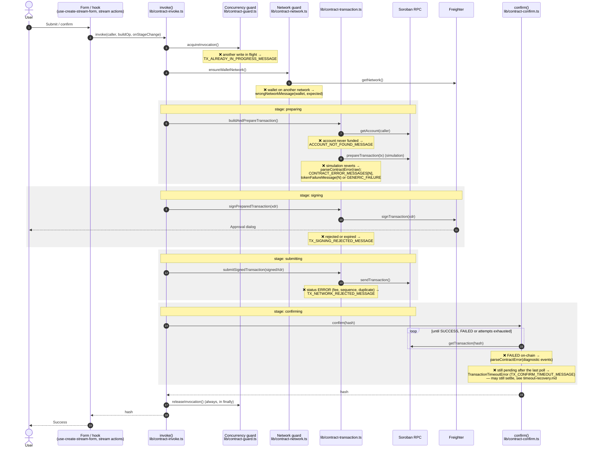

# Transaction write path

Every on-chain write (create, withdraw, cancel) runs through `invoke()` in
`lib/contract-invoke.ts`. This diagram follows one transaction from the form
to confirmation and marks, with ❌, where each kind of failure is raised and
the message the user sees. The stage names (`preparing`, `signing`,
`submitting`, `confirming`) are the `TxStage` values shown by
`components/transaction-progress.tsx`.

## Failure summary

| Step | Raised in | Message |
| --- | --- | --- |
| Concurrency guard | `lib/contract-invoke.ts` | `TX_ALREADY_IN_PROGRESS_MESSAGE` |
| Network guard | `lib/contract-network.ts` | `wrongNetworkMessage(...)` |
| Account lookup | `lib/contract-transaction.ts` | `ACCOUNT_NOT_FOUND_MESSAGE` |
| Simulation | `lib/contract-transaction.ts` | `parseContractError` → contract/token/generic message |
| Signing | `lib/contract-transaction.ts` | `TX_SIGNING_REJECTED_MESSAGE` |
| Submission | `lib/contract-transaction.ts` | `TX_NETWORK_REJECTED_MESSAGE` |
| Confirmation (failed) | `lib/contract-confirm.ts` | `parseContractError` → contract/token/generic message |
| Confirmation (timeout) | `lib/contract-confirm.ts` | `TransactionTimeoutError` / `TX_CONFIRM_TIMEOUT_MESSAGE` |

The message strings live in `lib/contract-messages.ts` and
`lib/contract-errors.ts`. How each one is shown is described in
[api-error-handling.md](api-error-handling.md); recovering a timed-out
confirmation is covered in [timeout-recovery.md](timeout-recovery.md). To add
or change a contract error message, see
[adding-contract-error-messages.md](adding-contract-error-messages.md).
